# Shelter Volunteers — System Design
Design artifacts for both halves of the repo: the **React client** (`client_app/`) and the **Flask API** (`server/`). Diagrams are [Mermaid](https://mermaid.js.org/), so GitHub renders them on this page. Red-shaded boxes mark **technical debt / gaps** between the current and intended state.
| # | Section | Notation |
|---|---|---|
| 1 | [System & deployment architecture](#1-system--deployment-architecture) | Deployment diagram, CI/CD flowchart |
| 2 | [Software architecture](#2-software-architecture-inside-both-apps) | Layered component diagrams |
| 3 | [Data model](#3-data-model-mongodb-volunteers_db) | Entity-relationship diagram |
| 4 | [Shift sign-up, waitlist & reminders](#4-shift-sign-up-waitlist--reminders) | UML state diagram, sequence diagram, flowchart |
| 5 | [Auth & user flows](#5-authentication--user-flows) | Sequence diagram, IA tree, user flows |

## Context

**What we made and why.** Shelter Volunteers is an *existing* product (React client + Flask API + MongoDB) about to be handed to the SLU OSS department for public launch on WWT-provided hosting. Its new maintainers need three things: how the system is deployed (Section 1), where code goes and why (Sections 2–3), and how the parts of the domain that are hardest to follow behave (Sections 4–5). We skipped wireframes because they already exist in [`/wireframes`](../wireframes), and the UI is built. Instead, 5b maps the real screens from `App.js`.

**Key decisions and trade-offs shown**
- **Single VM with Docker Compose and Caddy** (1a). It's cheap, works on any host, and gets TLS automatically. The trade-off is no horizontal scaling.
- **In-process reminder scheduler** (1a, 4c). No extra worker service to run, but the API has to stay on **one gunicorn worker** or every email gets sent twice.
- **Clean architecture on the server** (2a). Use cases get repositories passed in, so business rules (capacity, time overlap, FIFO promotion) get tested without a database.
- **Identity is delegated to Google** (5a). We never store passwords. Email is the user key across `user_info`, `permissions` and commitments (3).
- **Automatic waitlist promotion** (4a/4b). A cancellation or a raised capacity fills the open spot right away, with no shelter admin action needed.

**How these inform development**
- Onboarding: new contributors start with Section 2a to see which layer a change belongs in.
- The red items are the backlog for hardening before launch, roughly in priority order:
  1. Implement the reminder repository methods (`find_shifts_due_for_reminder`, `mark_reminder_sent`).
  2. Add unique indexes on commitment and waitlist entries.
  3. Delete the legacy `WorkShift` stack and the unregistered `schedule_bp`.
  4. Consolidate the two HTTP clients.
- Deployment: table 1c is the checklist for the move to WWT (real domain, staging environment, rollback by `:sha` tag).

**Current vs. intended state (summary)**

| Area | Current | Intended |
|---|---|---|
| Hosting | AWS EC2, placeholder domains, prod only | WWT VM, real domain owned by OSS dept, staging + prod |
| Reminders | Logic and tests exist; Mongo methods missing | Fully wired, flags stored on `service_shifts` |
| Data integrity | Dedup enforced only in use cases | Unique DB indexes as a backstop |
| Codebase | Legacy `shifts`/`WorkShift` code and two HTTP clients | One model, one client |
| Scaling | 1 API worker (scheduler coupling) | Scheduler split out if load requires >1 worker |

---

## 1. System & Deployment Architecture

How the two halves of the repo — the **React client** (`client_app/`) and the **Flask API** (`server/`) — are built, shipped and hosted.

### 1a. Runtime architecture (production)

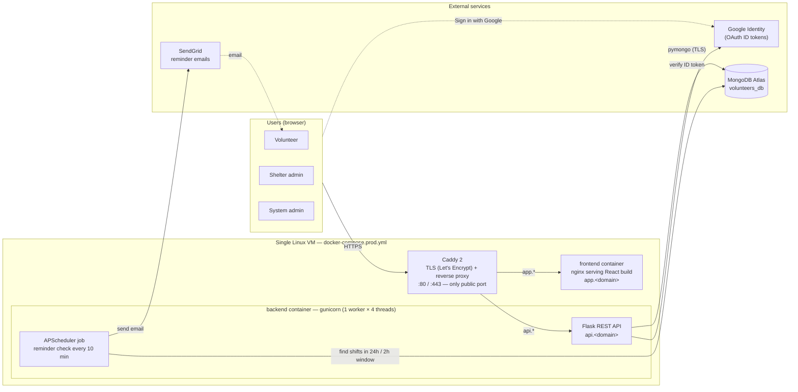

**Key decision:** the reminder scheduler runs *inside* the API process, so the backend is pinned to **one gunicorn worker** (more workers = duplicate emails). This keeps hosting to a single VM with no queue/worker service, at the cost of horizontal scaling.

### 1b. Build & deploy pipeline (`.github/workflows/ci-cd.yml`)

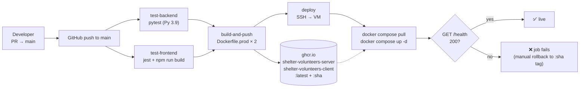

### 1c. Current vs. intended state

| | Current (Oct 2026) | Intended (launch / handover) |
|---|---|---|
| Host | AWS EC2 via SSH secrets | WWT-provided VM; same Compose file (platform-agnostic) |
| Domains | `Caddyfile` placeholders (`app.yourdomain.org`) | Real domain owned by SLU OSS dept |
| Environments | production only | add **staging** (separate Atlas cluster, same images) |
| Rollback | manual re-tag | deploy pinned `:sha` tag, keep last N |
| Scheduler | in-process APScheduler, 1 worker | split into its own container/cron if API needs >1 worker |
| Local dev | `docker-compose.yml` with local `mongo` + seed of legacy `shifts` data | seed current collections (`shelters`, `service_shifts`, …) |

---

## 2. Software Architecture (inside both apps)

### 2a. Backend layers — Clean Architecture (`server/`)

Dependencies point **inward only**: REST → use cases → domain. Use cases receive repositories as arguments, which is what makes them unit-testable with mocks (`server/tests/use_cases/`).

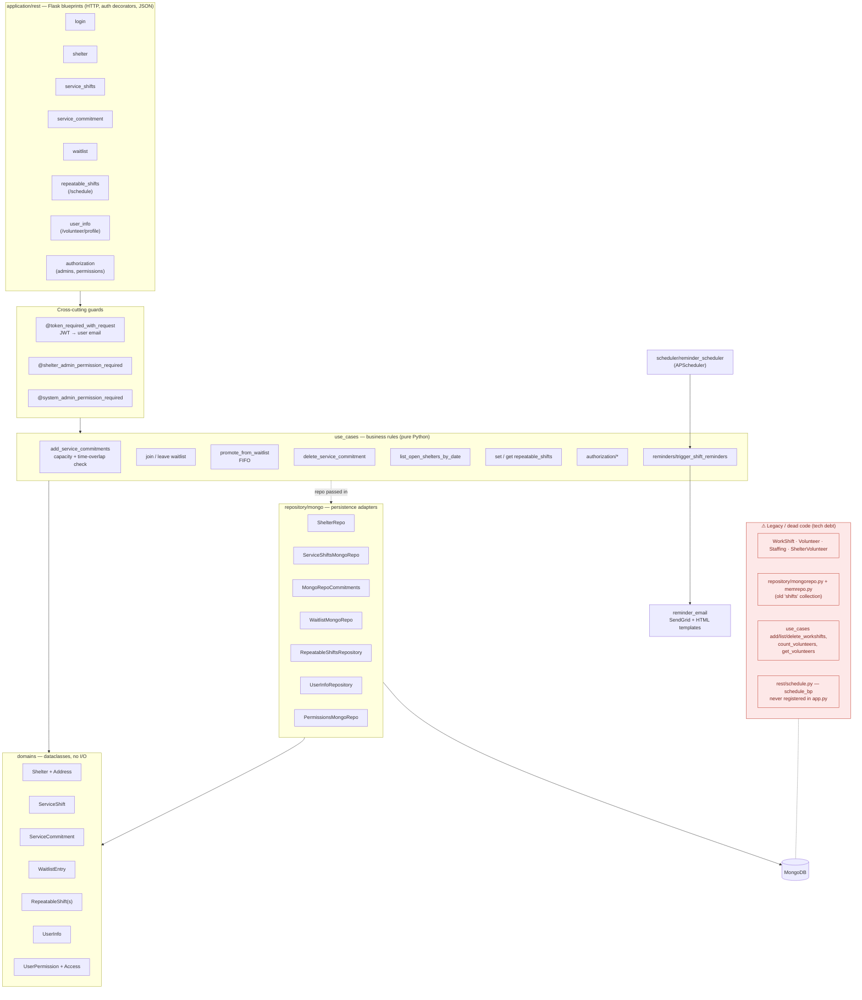

### 2b. Frontend structure (`client_app/src/`)

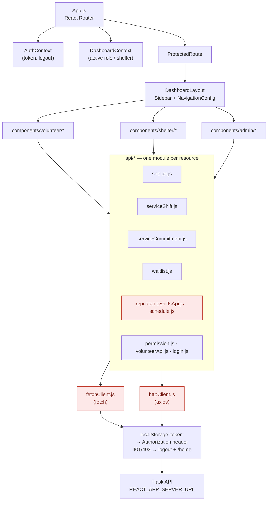

#### Technical debt shown in red

| Item | Why it matters | Planned fix |
|---|---|---|
| Two HTTP clients (`fetchClient` + axios `httpClient`) with duplicated auth/401 logic | Bugs fixed in one aren't fixed in the other | Consolidate on one client |
| `schedule.js` and `repeatableShiftsApi.js` both call `/shelters/:id/schedule` | Two code paths for the same endpoint (ScheduleManager vs RepeatableShifts screen) | Merge into one module |
| `rest/schedule.py` + `ScheduleMongoRepo` (not registered) share the `schedule` collection with `RepeatableShiftsRepository` | Confusing; two document shapes in one collection | Delete dead blueprint/repo |
| Legacy `WorkShift` model, `mongorepo.py`, `memrepo.py`, workshift use cases, `cli.py` | Pre-redesign model; local `docker-compose.yml` still seeds it | Delete + update seed data |
| `ServiceShiftsMongoRepo` lacks `find_shifts_due_for_reminder` / `mark_reminder_sent` (only mocked in tests) | Reminder job will error once `SENDGRID_API_KEY` is set | Implement + add repo test |

---

## 3. Data Model (MongoDB `volunteers_db`)

MongoDB has no foreign keys — the relationships below are **by convention** (string ids / emails) and enforced in the use cases, not the database.

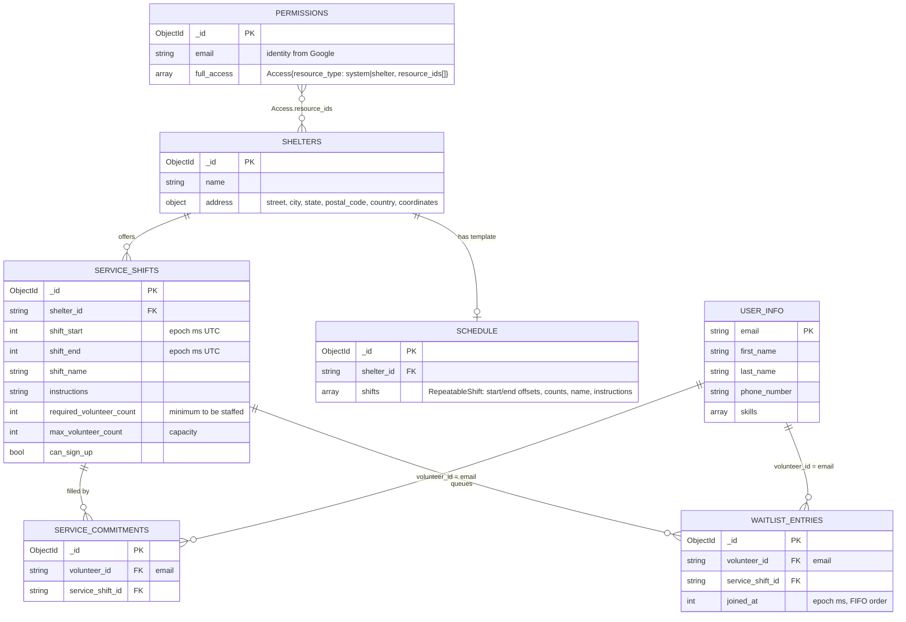

**Notes**
- Users are **not** stored as accounts — identity comes from Google; `USER_INFO` (profile) and `PERMISSIONS` (roles) are both keyed by email. No `PERMISSIONS` row = plain volunteer.
- `SCHEDULE` is a *template*; opening a shelter on a date copies template shifts into concrete `SERVICE_SHIFTS` rows.
- **Intended:** add unique index on (`volunteer_id`, `service_shift_id`) in `service_commitments` and `waitlist_entries` to make the "no double sign-up" rule a DB guarantee; add reminder-sent flags on `service_shifts`; drop legacy `shifts` collection.

---

## 4. Shift Sign-up, Waitlist & Reminders

The core workflow of the product: a shelter publishes a shift, volunteers fill it, overflow queues on a waitlist, and openings are back-filled automatically.

### 4a. Shift state diagram

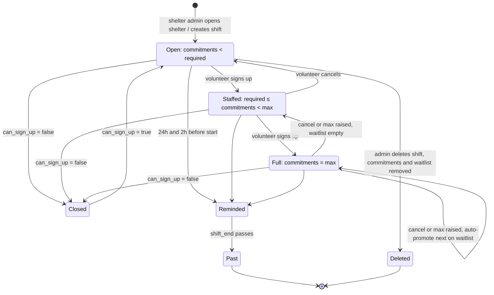

### 4b. Sign-up / cancel sequence (with waitlist promotion)

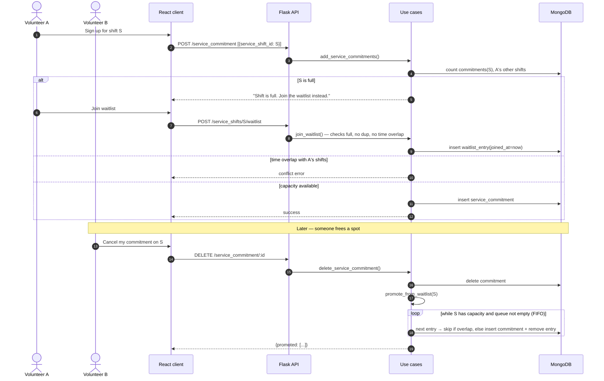

### 4c. Reminder job

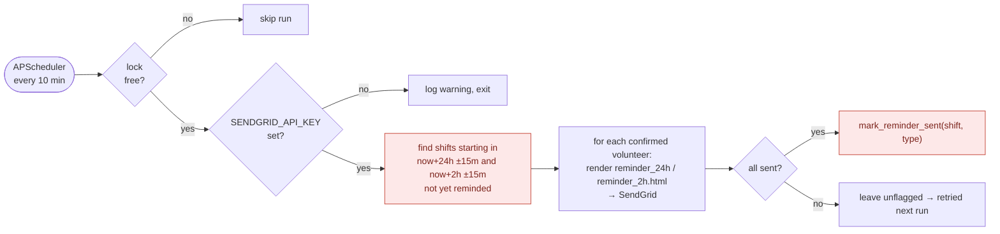

> Red boxes: the use case calls these repository methods, but `ServiceShiftsMongoRepo` doesn't implement them yet (tests use mocks). Must be built before reminders are switched on in production.

---

## 5. Authentication & User Flows

### 5a. Login and authorization sequence

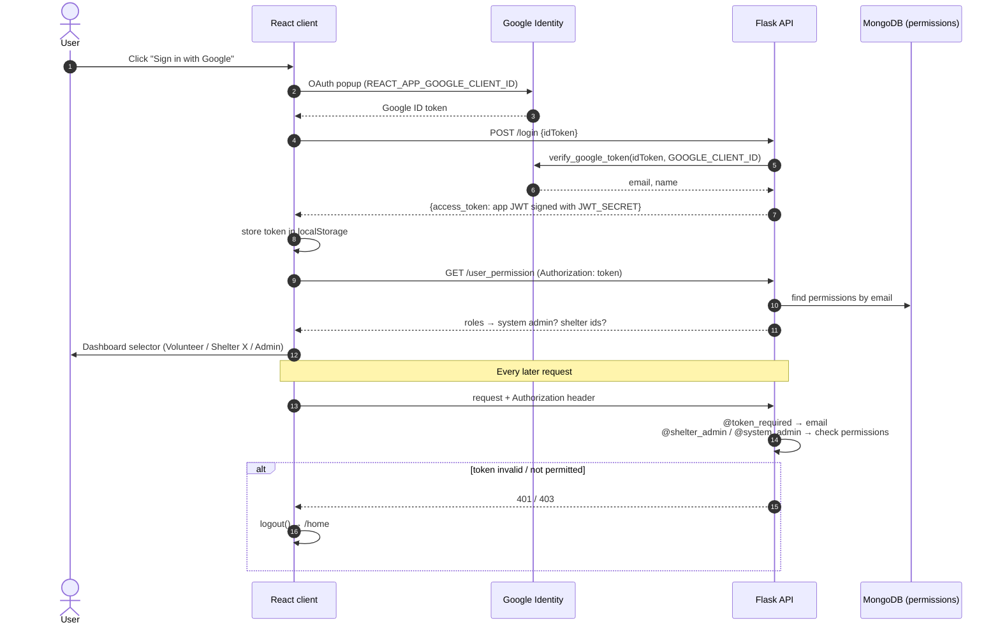

### 5b. Information architecture — screens by role (`App.js` routes)

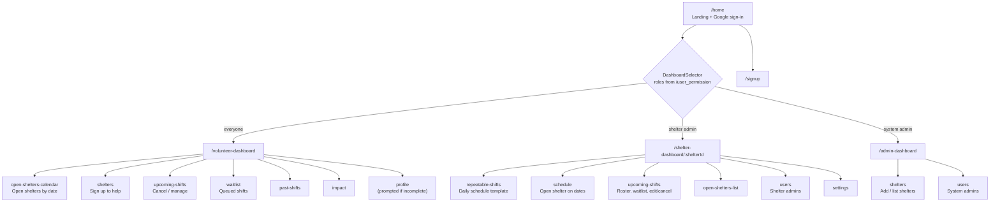

### 5c. Primary task flows

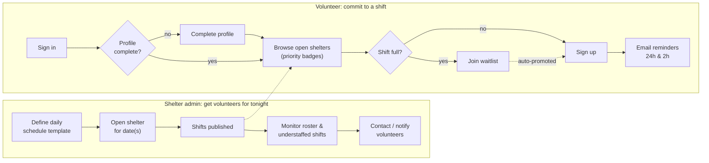

---

*This is a living document. Update the relevant diagram in the same PR that changes the architecture.*
